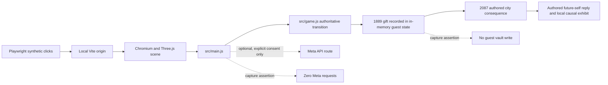

# Local authored demo rehearsal

This runbook describes a safe synthetic-data browser recording. It is not a live Meta demo, public preview, final submission video, hardware performance test, or eligibility claim.

## What the capture does

The Node/Playwright script starts the local Vite app and system Chromium at `1280×720`, enters a new unsaved guest session, visits the imagined future self, makes the Aether Cell gift choice in 1889, observes the public-workshop outcome in 2087, and asks the future self to recall the recorded fictional choice. Dialogue is authored and offline. A recording-only overlay explicitly says `LOCAL CAPTURE · AUTHORED OFFLINE · META DISABLED`; it is injected by the capture script and is not an app feature.

The script fails if the guest creates a vault, a Meta/off-origin request occurs, a required interaction target is obscured, the expected consequence/exhibit is missing, the browser reports an error, or the resulting media is invalid. The capture asserts that the exhibit is the authored people/gift exhibit and belongs to the current world and Prime branch. No user-authored private text or credentials are used.

## Runtime and data boundaries



For this recording, consent is never enabled and the Meta route is never called. `src/game.js` supplies state and consequence facts; dialogue and exhibit content are authored. Separate lifecycle tests exercise mocked local-model and Meta responses, which are not live provider evidence. The app's actual privacy labels distinguish guest storage from the selected dialogue transport; tests assert guest/authored, guest/on-device mock, guest/Meta mock, saved/on-device mock, and saved/Meta mock wording.

## Reproduce

Requirements: Node 22+, dependencies installed with `npm ci`, system Chromium (`/usr/bin/chromium` in the captured environment), and `ffmpeg` plus `ffprobe` on `PATH`. The Playwright browser download's bundled ffmpeg was unavailable in this environment; the script uses system binaries instead.

```bash
npm run demo:record:authored
ffprobe -v error -show_entries stream=codec_name,width,height,avg_frame_rate -show_entries format=duration,size -of json review-output/demo-local/elsewhere-authored-offline.mp4
```

By default, output goes to ignored `review-output/demo-local/`. Override with `ELSEWHERE_DEMO_OUTPUT=/safe/local/path`; override executable locations with `PLAYWRIGHT_CHROMIUM_EXECUTABLE`, `FFMPEG_PATH`, and `FFPROBE_PATH`. The script listens on `127.0.0.1:5189`; change this with `ELSEWHERE_DEMO_PORT` if needed.

The capture uses Chrome DevTools Protocol JPEG screencast frames and ffmpeg's concat demuxer, preserving real variable intervals between captured frames. It does not synthesize smooth motion between frames. Frame cadence depends on browser/render load; inspect `avg_frame_rate` and watch the output before using it. The current local file is a choppy rehearsal, not a polished video. Extracted review frames are `frame-008.png`, `frame-052.png`, and `frame-099.png` in the same ignored directory; they show the start/1889/2087 sequence and were manually inspected for text and visible scene context.

## Evidence and limitations

Captured environment: system Chromium `154.0.8037.57`, `1280×720` CSS pixels, DPR 1, SwiftShader software WebGL, synthetic guest state. Current recorded media: H.264, `1280×720`, `119.16` seconds, `1,762,745` bytes, 87 captured frames, reported average frame rate `725/993` (~0.73 fps). Assertions recorded zero guest vault writes, Meta requests, off-origin requests, page errors, console errors and HTTP errors.

The capture is stored locally and ignored by Git; no artifact-transfer connector is available here. It has not been published. A lower-cost CDP probe with 640×360 JPEG frames, immediate acknowledgements, and no disk writes produced only 21 frames in 15 seconds (1.40 fps); the actual app’s SwiftShader panel varied from 20 FPS before the probe to 12 during it and 8 after a 24-second quiet window. This did not establish a stable cause, but it ruled out disk writes as the only limit and showed the environment cannot produce smooth capture. The existing MP4 was fully decoded successfully but remains choppy. Do not interpolate, duplicate or speed up frames to disguise performance. A hardware-assisted follow-up must run the same 1280×720 scene on a named physical GPU/device with matched no-capture and capture intervals, then inspect real video cadence and app frame timings. This evidence does not prove physical GPU/phone/Quest performance, live Meta use, human usability, official eligibility, submission compliance or a final three-minute demo. The participant guide supplied by the owner on 2026-10-31 requires a three-minute video; the present shot list is preparation, not fulfillment. Exact portal fields and other video-format requirements remain unchecked. Do not use this rehearsal clip as evidence that any external gate has passed.
